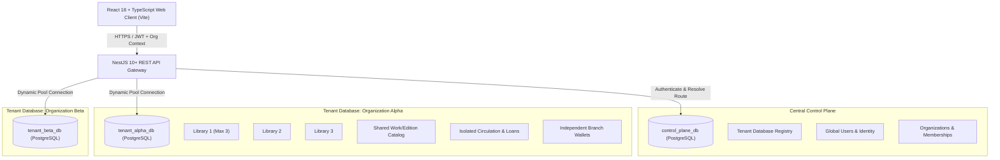

# Library Platform — System Architecture & ADRs

## 1. High-Level Architecture Overview

The Library Platform is a production-minded multi-tenant library management and social reading platform. It utilizes a central Control-Plane database for global identity and tenant routing, combined with completely isolated PostgreSQL Tenant databases per customer organization.

---

## 2. Architecture Decision Records (ADRs)

### ADR-001: ORM Selection — TypeORM over Prisma for Dynamic Multi-Tenancy

- **Status:** Accepted
- **Context:**
  The system requires one central control-plane database and dynamically provisioned, completely isolated PostgreSQL tenant databases (one per customer organization). At runtime, when an organization signs up or an existing organization makes API requests, the backend must dynamically resolve and connect to that organization's specific database.
- **Evaluation:**
  - **Prisma:** While Prisma offers exceptional query typing, its engine is a compiled Rust binary. In Prisma, each distinct database connection requires instantiating an entire `PrismaClient` instance with its own internal connection pool and engine lifecycle. Running dozens or hundreds of tenant databases at runtime causes excessive memory usage, lacks native LRU connection pool eviction, and makes programmatic multi-tenant migration runners cumbersome.
  - **TypeORM:** TypeORM integrates directly with NestJS and standard Node `pg` connection pools. It allows the programmatic instantiation of `DataSource` instances at runtime, fine-grained control over connection pool size (e.g., min: 1, max: 10 per tenant) and idle timeouts (`idleTimeoutMillis`), clean connection lifecycle hooks (`dataSource.initialize()`, `dataSource.destroy()`), and direct execution of programmatic migrations (`dataSource.runMigrations()`).
- **Decision:**
  We select **TypeORM** as the single unified ORM across both the Control Plane and Dynamic Tenant databases.

---

### ADR-002: Dynamic Tenant Connection Lifecycle & Connection Pool Management

- **Status:** Accepted
- **Context:**
  A separate database per organization provides strong security, easy backup/restore, and compliance isolation, but requires a robust connection pooling strategy to avoid exhausting database connection limits.
- **Decision:**
  1. **Control-Plane Connection:** A single persistent `DataSource` initialized on application boot connecting to `control_plane_db`.
  2. **Tenant Connection Manager (`TenantConnectionService`):**
     - Maintains an in-memory LRU cache of initialized `DataSource` instances keyed by `organization_id`.
     - Max active tenant pools in memory: 50.
     - Idle connection pool eviction: 10 minutes. If no requests are received for a tenant database within 10 minutes, the pool is gracefully drained and closed (`dataSource.destroy()`).
     - Connection limits per tenant pool: `min: 1, max: 10`.
     - Connection establishment: Upon receiving a valid request with an organization context, the interceptor checks the cache. If absent, it queries `TenantDatabaseRegistry` in the control plane, retrieves credentials, initializes the `DataSource`, and caches it.

---

### ADR-003: Multi-Tenant Schema Migration Orchestration

- **Status:** Accepted
- **Context:**
  Because each tenant has its own isolated database, schema changes must be applied predictably to all existing tenant databases as well as new databases created during organization onboarding.
- **Decision:**
  1. Two isolated migration suites:
     - `database/control-plane/migrations`: Migrates `control_plane_db`. Runs on deployment boot.
     - `database/tenant/migrations`: Migrates the organization tenant template.
  2. **Onboarding Execution:** When an organization is created, the control plane provisions the PostgreSQL database, connects to it, and immediately executes `dataSource.runMigrations()` before seeding initial library data.
  3. **Fleet Migration Runner:** A dedicated maintenance script (`npm run migration:run:tenants`) reads all active organizations from `tenant_database_registry`, iterates through them with a concurrency limit of 5, applies pending migrations, and records the current `schema_version`.

---

### ADR-004: Strict Non-Synchronization Between Libraries (Max 3 per Organization)

- **Status:** Accepted
- **Context:**
  An organization can contain up to three independent libraries. Library inventory, circulation, reservations, wallets, settings, and other records must not synchronize across libraries.
- **Decision:**
  1. A database trigger and check function in the tenant database enforces `COUNT(*) <= 3` on the `libraries` table.
  2. Every physical copy (`book_copies`), loan (`loans`), reservation (`reservations`), location (`locations`), and setting (`library_settings`) carries a mandatory `library_id` foreign key.
  3. Wallets are partitioned by `(library_id, user_id)`. A patron visiting Library 1 maintains an independent wallet balance and transaction ledger separate from Library 2.
  4. Cross-library borrowing or automatic hold fulfillment across branches is prohibited.
  5. Intellectual works (`books`) and editions (`book_editions`) are defined at the organization tenant level so catalog metadata can be curated once within an organization without re-entry, while all physical copies and transactions remain strictly isolated per library branch.
